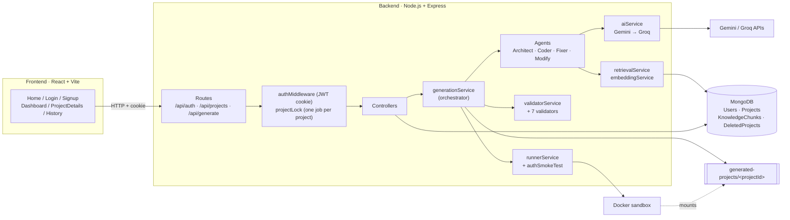
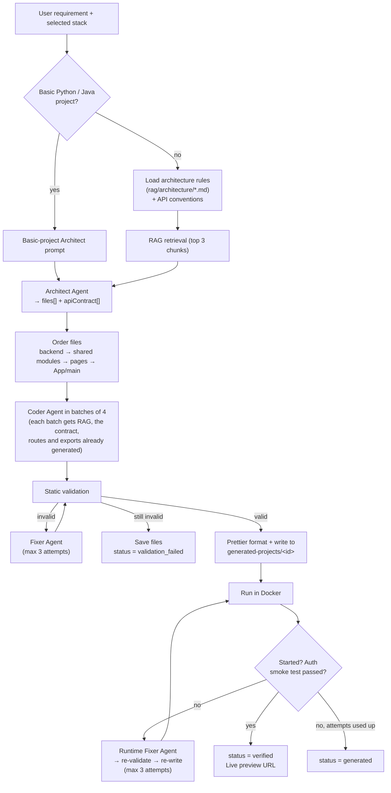
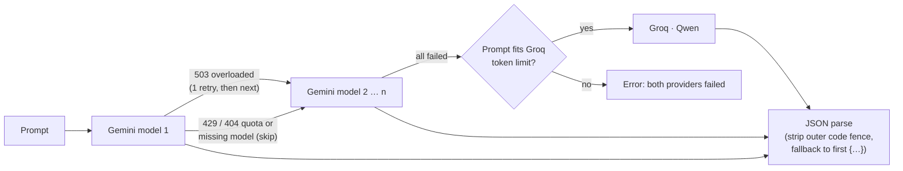

# 🤖 Intelligent Autonomous App Builder

> An AI-powered platform that turns a natural-language requirement and a chosen technology stack into a complete, runnable project, using a multi-agent pipeline (Architect → Coder → Validator → Fixer), Retrieval-Augmented Generation (RAG), and sandboxed Docker execution with automatic self-healing.

---

## 📌 Table of Contents

- [Overview](#-overview)
- [Key Features](#-key-features)
- [Technology Stack](#️-technology-stack)
- [System Architecture](#️-system-architecture)
- [Generation Workflow](#-generation-workflow)
- [Modify Workflow](#️-modify-workflow)
- [AI Agents](#-ai-agents)
- [AI Provider Layer](#-ai-provider-layer)
- [RAG Pipeline](#-rag-pipeline)
- [Validation Layer](#-validation-layer)
- [Docker Runtime](#-docker-runtime)
- [Supported Project Types](#-supported-project-types)
- [Database Models](#️-database-models)
- [REST API](#-rest-api)
- [Project Structure](#-project-structure)
- [Getting Started](#-getting-started)
- [Environment Variables](#-environment-variables)
- [Security Measures](#-security-measures)
- [Limitations](#️-limitations)
- [Future Enhancements](#-future-enhancements)
- [Author](#-author)

---

## 📌 Overview

The user signs up, creates a project (name + technology stack), and describes the application in plain English. The backend then:

1. **Retrieves** stack-specific engineering knowledge from a RAG knowledge base.
2. **Plans** the project with an **Architect Agent** (file list, purpose of each file, API contract).
3. **Generates** the code in batches with a **Coder Agent**.
4. **Validates** the code with a set of static validators.
5. **Fixes** any errors with a **Fixer Agent** and re-validates (self-healing loop).
6. **Runs** the project in an isolated **Docker** container and, for apps with login, performs an **auth smoke test** (real signup → login → session).
7. Feeds any runtime error back to the Fixer Agent and retries.

The verified project is saved to MongoDB and to disk, can be previewed live, downloaded as a ZIP, or changed later with a natural-language **Modify** request.

```text
Requirement + Stack → RAG → Architect → Coder (batches) → Validator ⇄ Fixer
                                                              ↓
                                   Live Preview ← Docker Runtime ⇄ Runtime Fixer
```

---

## ✨ Key Features

| Feature | Description |
|---|---|
| Natural-language generation | Describe the app; the system produces every file |
| Stack as a hard constraint | The selected technologies override RAG knowledge and model preferences |
| Multi-agent pipeline | Separate Architect, Coder, Fixer and Modify agents |
| RAG knowledge base | Gemini embeddings + cosine similarity over curated Markdown docs, filtered by stack |
| Shared API contract | Fixed conventions + an Architect-generated endpoint list keep frontend and backend in sync |
| Static validation | Structure, API contract, module exports, features, data files, runtime config, Python/Java checks |
| Self-healing | Up to 3 static fix attempts and 3 runtime fix attempts |
| Docker runtime validation | Every project is started in a resource-limited sandbox before it is marked `verified` |
| Auth smoke test | For apps with login, real signup/login/session calls are made through the running app |
| Modify existing projects | Change or repair a project in plain English, with protected files and re-validation |
| AI provider fallback | Several Gemini models in order, then Groq (Qwen) |
| Accounts & history | JWT (HttpOnly cookie) auth, per-user projects, history of deleted projects |
| Download | Export any project as a ZIP |

---

## 🛠️ Technology Stack

### Platform (this repository)

| Layer | Technologies |
|---|---|
| **Frontend** | React 19, Vite 8, React Router 7, Tailwind CSS 4, shadcn/ui (Base UI), Lucide icons, Geist font, Fetch API |
| **Backend** | Node.js (ES modules), Express 5, Mongoose 9, JSON Web Tokens, bcryptjs, cookie-parser, CORS, express-rate-limit |
| **Database** | MongoDB (local or Atlas) |
| **Generative AI** | Google Gemini via `@google/genai` (primary), Groq via `groq-sdk` (fallback) |
| **Embeddings / RAG** | `gemini-embedding-001`, cosine similarity in Node.js, chunks stored in MongoDB |
| **Code formatting** | Prettier (generated files are formatted before saving) |
| **Packaging** | archiver (ZIP download) |
| **Sandbox runtime** | Docker (`nginx:alpine`, `node:22-alpine`, `node:22`, `python:3.12-slim`, `eclipse-temurin:21-jdk`) |
| **Tooling** | Nodemon, oxlint, Git |

### Default AI models

| Purpose | Model | Configurable with |
|---|---|---|
| Generation (tried in order) | `gemini-3.1-flash-lite` → `gemini-3.5-flash-lite` → `gemini-3.5-flash` → `gemini-3-flash-preview` | `GEMINI_MODELS` |
| Fallback generation | `qwen/qwen3.8-27b` on Groq | `GROQ_MODEL`, `GROQ_TPM_LIMIT` |
| Embeddings | `gemini-embedding-001` (`RETRIEVAL_DOCUMENT` / `RETRIEVAL_QUERY`) | — |

### Stacks a user can select

`HTML`, `CSS`, `JavaScript`, `React`, `Node.js`, `Express`, `MongoDB`, `Vite`, `Tailwind CSS`, `Next.js`, `MySQL`, `PostgreSQL`, `Python`, `Java`

How the selection maps to what gets generated is described in [Supported Project Types](#-supported-project-types).

---

## 🏗️ System Architecture



**Layers**

| Layer | Responsibility | Main files |
|---|---|---|
| Presentation | UI, forms, live progress, preview links | `frontend/src/pages`, `frontend/src/components` |
| API | Routing, auth, rate limiting, per-project locking | `backend/routes`, `backend/middleware`, `backend/utils/projectLock.js` |
| Orchestration | Runs the full pipeline and the fix loops | `backend/services/generationService.js`, `backend/controllers/projectController.js` (modify) |
| Agents | Prompt building for each role | `architectService.js`, `batchCoderService.js`, `fixerService.js`, `modifyProjectService.js` |
| Knowledge | Rules + RAG retrieval | `architectureRulesService.js`, `retrievalService.js`, `embeddingService.js`, `generationContract.js` |
| Verification | Static checks, Docker runs, smoke test | `validatorService.js`, `validators/`, `runnerService.js`, `authSmokeTest.js` |
| Persistence | MongoDB models, files on disk | `backend/models`, `fileGenerationService.js`, `writeProjectFiles.js` |

---

## 🔄 Generation Workflow

`POST /api/generate` → `generationController` → `generationService.generateApp()`



### Step-by-step

1. **Request:** the frontend sends `{ projectId, prompt }`. The project's stack is read from MongoDB, never from the request.
2. **Architecture rules:** `architectureRulesService` loads `rag/architecture/common.md` plus one rule file per detected area (`static-web`, `react-vite`, `mern`, `python-fastapi`, `java-springboot`). `techStackMatcher` maps the user's selection to these areas.
3. **API conventions:** for Express/MERN stacks, `generationContract.js` adds fixed rules (all routes under `/api`, Bearer token auth, `backend/config/jwt.js`, `AuthContext` exports, `_id` ids, JSON error shape). These override RAG.
4. **RAG retrieval:** the requirement + stack becomes a query embedding, and the top 3 chunks are added to the prompt (see [RAG Pipeline](#-rag-pipeline)).
5. **Architect Agent:** returns `projectName`, `description`, `techStack`, a `files[]` plan (`path` + `purpose`) and, for full-stack apps, an `apiContract[]` (method, path, auth, body, response).
6. **File ordering:** backend files come first, so frontend batches know which routes really exist. Inside the frontend, services/context/hooks/components come before pages, and `App`/`main` come last.
7. **Coder Agent:** writes files 4 at a time (`BATCH_SIZE = 4`). Each batch receives the full file plan, the API contract, the endpoints already implemented by earlier backend batches, and the exports of modules already generated, so imports match.
8. **Static validation + Fixer:** up to `MAX_FIX_ATTEMPTS = 3`. If errors remain, the files are still saved (status `validation_failed`) so the user can review, download or repair them with Modify.
9. **Write to disk:** files are formatted with Prettier and written to `backend/generated-projects/<projectId>/`. `MONGO_URI` lines that point to hosts unreachable from the sandbox are removed from `.env` files.
10. **Runtime validation:** `runnerService` detects the project type and starts it in Docker. For apps with login, `authSmokeTest` calls signup → login → `/me` through the frontend's `/api` proxy.
11. **Runtime Fixer:** a failure (container crash, build error, failed smoke test) goes back to the Fixer as a `RUNTIME_ERROR`. The result is re-validated statically (with its own fix loop if needed), rewritten and run again, up to `MAX_RUNTIME_FIX_ATTEMPTS = 3`.
12. **Save:** status is `verified` if runtime validation passed, otherwise `generated`.

---

## ✏️ Modify Workflow

`POST /api/projects/:id/modify` with `{ userRequest }`

1. The current files are validated first. The findings are given to the Modify Agent as **known problems**, so vague requests like *"fix the login"* target the real cause.
2. If the request is about appearance (e.g. *"make the UI better"*), `uiDesignRules.js` adds a design system, and only presentation files (React sources, templates/static files, root HTML/CSS/JS) may change.
3. **Protected files** (config and runtime data files) are never overwritten by AI output.
4. The result is statically validated and fixed (max 2 attempts), saved to MongoDB and disk, and checked on disk by `modifyValidatorService`.
5. The container is restarted, the auth smoke test runs again, and runtime failures go to the Fixer (max 2 attempts).

---

## 🤖 AI Agents

| Agent | File | Input | Output |
|---|---|---|---|
| **Architect** | `services/architectService.js` | Requirement, stack, architecture rules, API conventions, RAG context | File plan (`path`, `purpose`), API contract, description |
| **Coder** | `services/batchCoderService.js` | One batch of the plan, full plan, API contract, implemented endpoints, existing exports, RAG context | File contents for that batch |
| **Fixer** | `services/fixerService.js` | All files + static or runtime errors, API conventions | Corrected files (merged over the old ones) |
| **Modify** | `services/modifyProjectService.js` | Existing files, user request, known problems, optional UI rules | Changed / new files |

The Validator, Runner and Auth Smoke Test are **deterministic code, not LLM agents**. That keeps verification reliable and repeatable.

**Technology priority used by the Architect:**

1. The explicitly selected technology stack
2. Technology the user names in the requirement
3. API conventions and architecture rules
4. Retrieved RAG knowledge
5. General defaults

For example, if the user selects *HTML + CSS + JavaScript*, the result stays a static site even if React knowledge is retrieved.

---

## 🧠 AI Provider Layer

`services/aiService.js` exposes one function, `generateWithAI(prompt)`, which every agent uses and which always returns parsed JSON.



- Gemini is called with `responseMimeType: "application/json"`, and Groq with `response_format: json_object` and `temperature: 0`.
- Groq's free tier allows ~8,000 tokens/minute, so prompts estimated above `GROQ_TPM_LIMIT − 2000` are not sent to Groq.

---

## 📚 RAG Pipeline

### Knowledge sources

```text
backend/rag/
├── architecture/          # Rule files loaded directly (not embedded) by the Architect
│   ├── common.md
│   ├── static-web.md
│   ├── react-vite.md
│   ├── mern.md
│   ├── python-fastapi.md
│   └── java-springboot.md
└── documents/             # Embedded into MongoDB for semantic retrieval
    ├── common/            # api-design, authentication, docker, security
    ├── frontend/          # react-vite, static-web
    └── backend/           # mern, node-express, python-fastapi, java-springboot
```

### Phase 1: Indexing (`npm run index:kb`)

`scripts/indexKnowledgeBase.js`:

1. Recursively reads every `.md` file in `rag/documents/`.
2. Splits it into **1200-character chunks with 200-character overlap**.
3. Embeds each chunk with `gemini-embedding-001` (`RETRIEVAL_DOCUMENT`).
4. Stores `{ source, content, embedding, metadata: { chunkIndex, category, technology } }` in the `knowledgechunks` collection. `category` is the sub-folder and `technology` is the file name. The old chunks are deleted first.

### Phase 2: Retrieval (`services/retrievalService.js`)

```text
Requirement + stack ──► query embedding (RETRIEVAL_QUERY)
                               │
          KnowledgeChunks ─────┤ keep: category "common" + chunks whose
                               │       technology matches the selected stack
                               ▼
     score = 0.7 × cosine similarity + 0.3 × technology relevance
             (selected tech = 1.0, common = 0.8)
                               │
                 drop score < 0.60 → sort → top 3
                               ▼
                 Architect / Coder prompt context
```

Both the Architect and every Coder batch retrieve knowledge. Similarity is computed in Node.js over all stored chunks, which is fine for a small curated knowledge base.

---

## ✅ Validation Layer

`services/validatorService.js` returns `{ valid, errors[], warnings[] }`. It combines the following validators:

| Validator | Checks |
|---|---|
| `structureValidator` | Non-empty file list, valid entries, duplicate paths (empty files are warnings) |
| `apiContractValidator` | Every frontend API call hits a mounted backend route; auth flow (token transport, login fields, ids, auth state) matches on both sides |
| `moduleExportsValidator` | Every name imported from a local file is really exported (prevents blank React pages) |
| `featureValidator` | Authentication is complete: login and signup pages, navigation between them, auth API calls |
| `runtimeValidator` | The backend exposes a `GET /health` route (directly or through a mounted router) |
| `dataFilesValidator` | `backend/data/*.json` is valid JSON; read-only collections ship seed data |
| `consoleValidator` | Basic Python/Java projects: entry point, tests, no forbidden frameworks |

Errors are written as instructions the Fixer Agent can act on.

---

## 🐳 Docker Runtime

`services/runnerService.js` detects the project type from the files on disk and starts a container named after the project. Ports are published on `127.0.0.1` with a random host port, and the preview URL is returned to the frontend.

| Project type | Detected by | Image | Command | Limits |
|---|---|---|---|---|
| `fullstack` | `backend/` + `frontend/` | `node:22` | `npm install && npm start` (backend) · `npm run build` check + `npm run dev` (frontend) | 768 MB, 1 CPU, 150 PIDs |
| `react` | `frontend/` with React + Vite | `node:22-alpine` | `npm install && npm run dev` | 512 MB, 1 CPU, 100 PIDs |
| `python-web` | `server.py` | `python:3.12-slim` | `python server.py` | read-only FS |
| `java-web` | `src/Main.java` + `templates/` or `static/` | `eclipse-temurin:21-jdk` | `javac … && java Main` | read-only FS |
| `static` | root `index.html` | `nginx:alpine` | files mounted read-only | 256 MB, 1 CPU, 100 PIDs |
| `python` (console) | `main.py` | `python:3.12-slim` | `python main.py` + `unittest` | 256 MB, 64 PIDs, no network, 15 s |
| `java` (console) | `src/Main.java` | `eclipse-temurin:21-jdk` | `javac` + `java Main` + `TestRunner` | 512 MB, 256 PIDs, no network, 15 s |

All containers run with `--security-opt no-new-privileges` and `--cap-drop=ALL` (nginx gets back only the few capabilities it needs). Console and basic web projects also use `--read-only` with a writable `/tmp`.

> **Docker Desktop must be running.** Generation uses Docker for runtime validation, not only for the preview.

---

## 🧩 Supported Project Types

| Selected stack (examples) | Generated project |
|---|---|
| HTML / CSS / JavaScript | Static site: `index.html`, `style.css`, `script.js` |
| React (+ Vite, Tailwind) | React + Vite SPA in `frontend/` |
| React + Node.js / Express (+ MongoDB) | Full-stack: `frontend/` (Vite proxy `/api` → `:5001`) + `backend/` (Express, JWT Bearer auth). MongoDB when `MONGO_URI` is reachable, otherwise a JSON-file demo mode in `backend/data/` |
| Python only | Console program `main.py` + `tests/` (standard library) |
| Java only | Console program `src/Main.java` + `src/TestRunner.java` |
| Python + HTML/CSS(/JS) | `server.py` on Python's built-in `http.server`, plus `templates/` and `static/` |
| Java + HTML/CSS(/JS) | `src/Main.java` on Java's built-in `HttpServer`, plus `templates/` and `static/` |

Basic Python/Java projects use no frameworks (no Flask, Django, FastAPI or Spring Boot). Their logic stays in Python/Java rather than in JavaScript.

---

## 🗄️ Database Models

```text
User                 Project                    KnowledgeChunk          DeletedProject
├── name             ├── user → User            ├── source              ├── user → User
├── email (unique)   ├── name                   ├── content             ├── projectId
├── password (hash)  ├── description            ├── embedding [Number]  ├── name, description
└── timestamps       ├── techStack [String]     ├── metadata            ├── techStack, status
                     ├── status                 │   (chunkIndex,        ├── projectCreatedAt
                     ├── files [{path,content}] │    category,          └── deletedAt
                     └── timestamps             │    technology)
                                                └── timestamps
```

**Project status values:** `active` (created, not generated yet) → `verified` (validated and ran in Docker) / `generated` (validated, runtime check failed) / `validation_failed` (static errors remain, files saved for review).

Generated files live in **MongoDB** (source of truth) and in **`backend/generated-projects/<projectId>/`** (for Docker and ZIP download, git-ignored).

---

## 🔌 REST API

All routes except signup/login/logout require the `token` cookie. Every project route checks that the project belongs to the logged-in user.

### Auth: `/api/auth`

| Method | Path | Description |
|---|---|---|
| POST | `/signup` | Create an account (rate-limited: 10/hour per IP) |
| POST | `/login` | Log in and set an HttpOnly JWT cookie valid for 7 days (10 failed attempts per 15 min) |
| GET | `/me` | Current user |
| POST | `/logout` | Clear the cookie |

### Projects: `/api/projects`

| Method | Path | Description |
|---|---|---|
| POST | `/` | Create a project `{ name, description?, techStack[] }` |
| GET | `/` | List the user's projects |
| GET | `/history` | Deleted projects |
| GET | `/:id` | Project details |
| GET | `/:id/files` | Generated files |
| GET | `/:id/download` | ZIP download |
| POST | `/:id/run` | Run in Docker (with runtime auto-fix) and return preview URL(s) |
| POST | `/:id/modify` | Modify with `{ userRequest }` |
| DELETE | `/:id` | Stop the container, delete files, record in history |

### Generation: `/api/generate`

| Method | Path | Body |
|---|---|---|
| POST | `/` | `{ projectId, prompt }` |

Generate, run, modify and delete are wrapped in `withProjectLock`. A second operation on the same project while one is running returns **409 Conflict**.

---

## 📁 Project Structure

```text
App-builder/
├── backend/
│   ├── app.js                    # Express app, CORS, routes
│   ├── server.js                 # Env checks, DB connect, start server
│   ├── config/db.js              # Mongoose connection (sanitizeFilter on)
│   ├── controllers/              # auth, project (run/modify/delete…), generation
│   ├── middleware/authMiddleware.js
│   ├── models/                   # User, Project, KnowledgeChunk, DeletedProject
│   ├── routes/                   # authRoutes, projectRoutes, generationRoutes
│   ├── rag/
│   │   ├── architecture/         # Stack rule files for the Architect
│   │   └── documents/            # Knowledge base for embeddings
│   ├── scripts/
│   │   ├── indexKnowledgeBase.js # Build the RAG index
│   │   └── dev/                  # Manual test scripts (not automated tests)
│   ├── services/
│   │   ├── generationService.js  # Pipeline orchestrator
│   │   ├── aiService.js          # Gemini → Groq with JSON parsing
│   │   ├── architectService.js   # Architect Agent
│   │   ├── batchCoderService.js  # Coder Agent
│   │   ├── fixerService.js       # Fixer Agent
│   │   ├── modifyProjectService.js # Modify Agent
│   │   ├── embeddingService.js   # Gemini embeddings
│   │   ├── retrievalService.js   # Semantic retrieval
│   │   ├── architectureRulesService.js
│   │   ├── techStackMatcher.js   # Stack → knowledge areas
│   │   ├── generationContract.js # Shared API conventions
│   │   ├── consoleProject.js     # Basic Python/Java projects
│   │   ├── uiDesignRules.js      # Design rules for UI modifications
│   │   ├── validatorService.js   # Runs all validators
│   │   ├── validators/           # 7 focused validators
│   │   ├── runnerService.js      # Docker runner
│   │   ├── authSmokeTest.js      # Signup/login check on the running app
│   │   ├── sandboxEnv.js         # Sanitises generated .env files
│   │   ├── fileGenerationService.js / writeProjectFiles.js / syncProjectFiles.js
│   │   └── modifyValidatorService.js
│   ├── utils/                    # errorResponse, projectLock
│   └── generated-projects/       # Output (git-ignored)
│
├── frontend/
│   ├── src/
│   │   ├── pages/                # Home, Login, Signup, Dashboard, ProjectDetails, History
│   │   ├── components/           # Navbar, Sidebar, NewProject, ProjectsList, PromptBox,
│   │   │                         # AgentStatus, GenerationProgress, StatsCards, ui/ (shadcn)…
│   │   ├── layouts/DashboardLayout/
│   │   ├── lib/                  # api base URL, theme, project type helpers
│   │   ├── App.jsx               # Routes (protected: dashboard, history, projects/:id)
│   │   └── main.jsx
│   └── vite.config.js
│
└── README.md
```

---

## 🚀 Getting Started

### Prerequisites

- **Node.js 20+**
- **MongoDB** (local or Atlas)
- **Docker Desktop** (running)
- A **Gemini API key** (required for embeddings) and optionally a **Groq API key**

### 1. Install

```bash
git clone https://github.com/abhicse12/Smart-App-Builder.git
cd Smart-App-Builder

cd backend && npm install
cd ../frontend && npm install
```

### 2. Configure

```bash
cp backend/.env.example backend/.env      # then fill in the values
cp frontend/.env.example frontend/.env
```

### 3. Build the RAG index (once, and after editing `rag/documents/`)

```bash
cd backend
npm run index:kb
```

### 4. Run

```bash
# Terminal 1
cd backend
npm run dev        # or: npm start  →  http://localhost:5000

# Terminal 2
cd frontend
npm run dev        # → http://localhost:5173
```

Open `http://localhost:5173`, sign up, create a project, select a stack, and describe your app on the project page.

---

## 🔐 Environment Variables

### `backend/.env`

| Variable | Required | Default | Purpose |
|---|---|---|---|
| `MONGO_URI` | ✅ | — | MongoDB connection string |
| `JWT_SECRET` | ✅ | — | JWT signing secret (32+ characters recommended) |
| `GEMINI_API_KEY` | ✅* | — | Gemini generation + embeddings |
| `GROQ_API_KEY` | — | — | Groq fallback |
| `PORT` | — | `5000` | API port |
| `GEMINI_MODELS` | — | see above | Comma-separated Gemini model order |
| `GROQ_MODEL` | — | `qwen/qwen3.8-27b` | Groq fallback model |
| `GROQ_TPM_LIMIT` | — | `8000` | Groq tokens/minute limit |
| `CLIENT_URL` | — | `http://localhost:5173` | Allowed frontend origin(s), comma-separated |
| `NODE_ENV` | — | — | `production` hides error details and sets a `Secure` cookie |

\* The server starts without it, but RAG retrieval needs Gemini embeddings.

### `frontend/.env`

| Variable | Default | Purpose |
|---|---|---|
| `VITE_API_URL` | `http://localhost:5000` | Backend base URL (without `/api`) |

---

## 🛡️ Security Measures

- Passwords hashed with **bcrypt** (input capped at 72 bytes).
- JWT stored in an **HttpOnly, SameSite=Lax** cookie (`Secure` in production).
- **Rate limiting** on login (failed attempts only) and signup.
- **`sanitizeFilter`** in Mongoose blocks NoSQL operator injection.
- Every project query is scoped to the logged-in user.
- Input length limits on project name, description and stack.
- Generated code runs only in **Docker** with memory/CPU/PID limits, `no-new-privileges` and dropped capabilities, published on `127.0.0.1` only.
- Production error responses omit internal details.

---

## ⚠️ Limitations

- Runs on a single backend process: the project lock is in memory.
- Generation is a long synchronous HTTP request with no streaming progress.
- RAG similarity is computed in application code. That is fine for a small knowledge base, but it does not scale to large corpora.
- `Next.js`, `MySQL` and `PostgreSQL` can be selected, but they have no dedicated rule or knowledge files yet.
- The AI providers' free-tier limits can slow down or block generation.
- There are no automated tests yet; `backend/scripts/dev/` holds manual scripts.

---

## 🔮 Future Enhancements

- MongoDB Atlas Vector Search instead of in-memory cosine similarity
- Streaming agent progress (Server-Sent Events / WebSockets) and background jobs
- Test Agent (unit and end-to-end test generation) and browser-based UI testing
- Security Agent (dependency and code scanning)
- Rule and knowledge files for Next.js, SQL databases, Django/Flask
- GitHub export and one-click deployment
- Project versioning and diff view for modifications
- Exposing generation, validation and RAG search as an **MCP (Model Context Protocol) server** for IDE-based AI assistants

---

## 🎓 Academic Significance

The project combines Generative AI, Large Language Models, Multi-Agent Systems, Retrieval-Augmented Generation, vector embeddings and semantic search, contract-driven code generation, automated static and runtime validation, self-healing loops, container sandboxing and full-stack web development. It shows AI used inside a structured software engineering workflow, not only as an isolated code generator.

---

## 👨‍💻 Author

**Abhishek Pandey**
B.Tech, Computer Science & Engineering (Artificial Intelligence & Machine Learning)
G H Raisoni College of Engineering and Management, Pune

- GitHub: [abhicse12](https://github.com/abhicse12)
- LinkedIn: [abhishekpandey12](https://linkedin.com/in/abhishekpandey12)

## 📜 License

Developed for academic, educational and research purposes. Add an open-source license before any public release.
